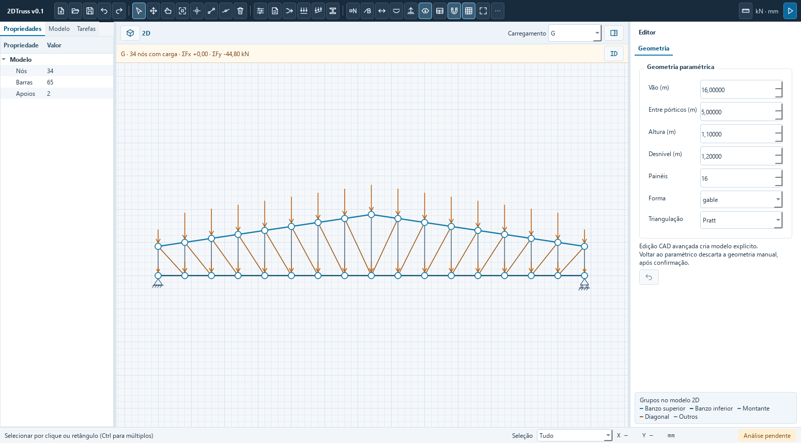
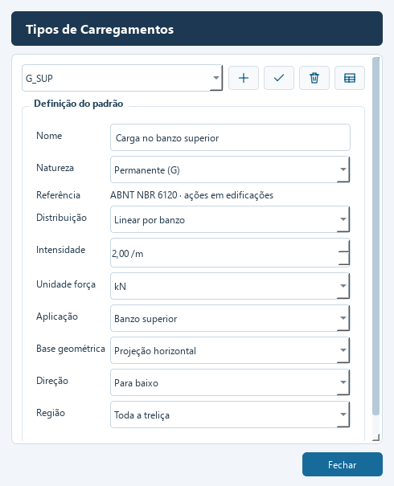
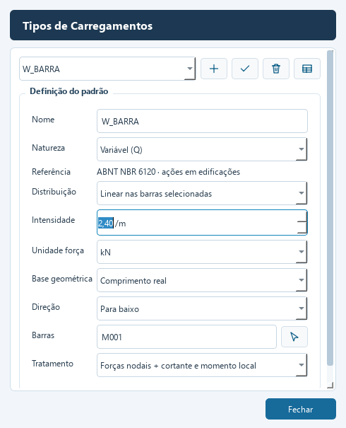
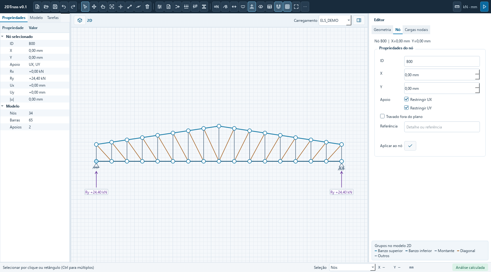
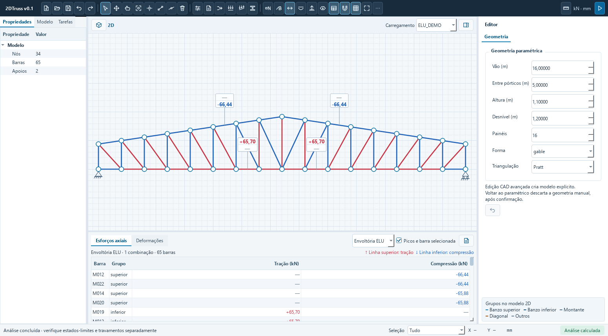
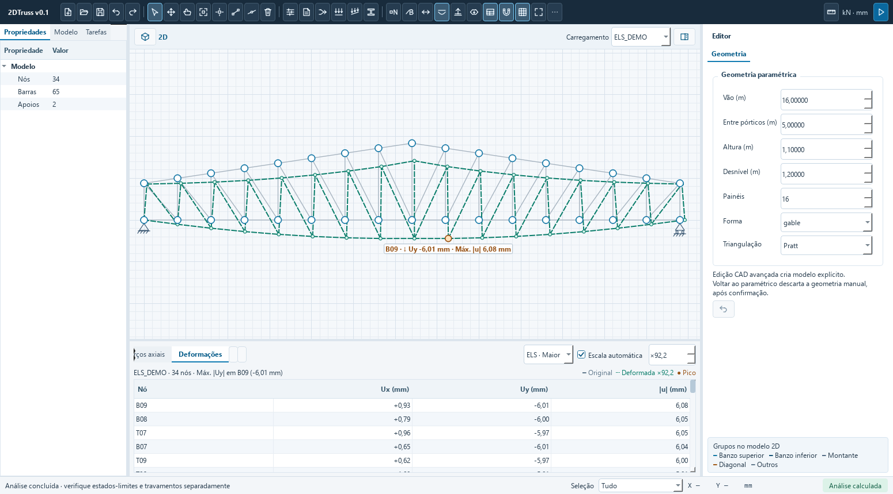
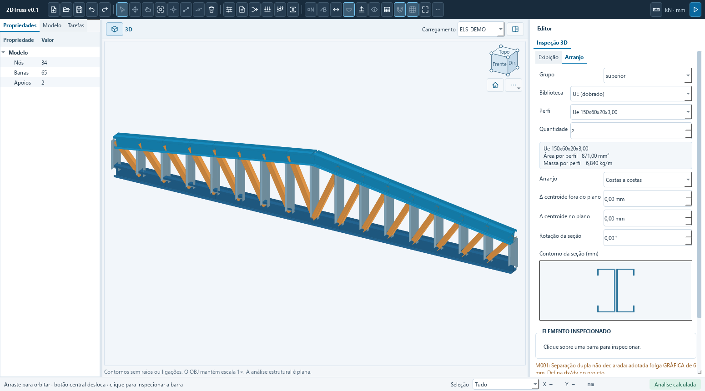

# Manual do usuário do 2DTruss v0.1

Aplicativo desktop para modelagem e análise linear elástica de treliças planas. Neste roteiro você abre uma cobertura Pratt de 16 m, confere cargas lineares diferentes nos dois banzos, verifica o equilíbrio e lê os esforços de ELU e os deslocamentos de ELS.

**Arquivo para acompanhar** — [Pratt de 16 m](../examples/manual_pratt_16m.json). O arquivo já contém as definições do roteiro. Abra uma cópia se quiser refazer os cadastros. Os valores de carga, coeficientes e perfis foram escolhidos para demonstrar o fluxo de trabalho.

## Conteúdo

- [Abrir e conhecer a área de trabalho](#1-abrir-e-conhecer-a-área-de-trabalho)
- [Conferir geometria, apoios e perfis](#2-conferir-geometria-apoios-e-perfis)
- [Definir e visualizar os carregamentos](#3-definir-e-visualizar-os-carregamentos)
- [Calcular e conferir o equilíbrio](#4-calcular-e-conferir-o-equilíbrio)
- [Ler esforços axiais e envoltórias](#5-ler-esforços-axiais-e-envoltórias)
- [Ler deslocamentos e deformada](#6-ler-deslocamentos-e-deformada)
- [Inspecionar em 3D, registrar travamentos e resistências](#7-inspecionar-em-3d-registrar-travamentos-e-resistências)
- [Salvar, exportar e validar](#8-salvar-exportar-e-validar)
- [Editar a malha ou importar CAD](#9-editar-a-malha-ou-importar-cad)
- [Resolver problemas comuns](#10-resolver-problemas-comuns)

## 1. Abrir e conhecer a área de trabalho

1. No Windows, abra o executável portátil mantendo os arquivos do pacote na mesma pasta. A partir do repositório, execute **INSTALAR_DEPENDENCIAS_USUARIO.bat** na primeira vez e use **INICIAR_DESKTOP.bat** para abrir o aplicativo. [Instalação e execução](../LEIA-ME_DESKTOP.md#execução-no-windows-sem-privilégios-administrativos)
2. Pressione **Ctrl+O**, localize **manual_pratt_16m.json** e clique em **Abrir**. Em **Novo**, o programa começa com seu próprio projeto demonstrativo.
3. Para praticar alterações sem sobrescrever o exemplo, faça uma cópia do JSON, abra essa cópia e use **Ctrl+S** conforme avança.

| Área | O que você encontra |
|---|---|
| Barra superior | Arquivo, edição, carregamentos, perfis, controles de exibição, unidades, **Mais comandos** e **Calcular**. Mantenha o cursor sobre um ícone para ler seu nome. |
| Painel esquerdo | **Propriedades** resume o objeto selecionado. **Modelo** localiza nós e barras por ID ou grupo. **Tarefas** dá acesso às ferramentas do projeto. |
| Desenho | Seleção e inspeção da treliça. O botão **2D / 3D** fica no canto superior esquerdo. O seletor **Carregamento** e o botão para recolher o editor ficam à direita. |
| Editor à direita | **Geometria** e controles que mudam conforme a seleção, como posição e apoios de nós ou grupo das barras. |
| Painel inferior | Abas **Esforços axiais** e **Deformações**. Abre depois de calcular. A barra de estado mostra coordenadas e situação da análise. |

### Navegar e fazer sua primeira seleção

1. Clique em **Selecionar** na barra de ícones e deixe **Seleção → Tudo** na barra inferior. Clique no centro de um nó e confira o ID e as coordenadas em **Propriedades**. Clique próximo ao eixo de uma barra para consultar seu grupo e perfil. Confira as cores dos grupos na legenda do editor.
2. Experimente **Seleção → Barras**. Comece o retângulo acima e à esquerda de uma barra e solte abaixo e à direita. Só entram as barras com o eixo inteiro dentro da janela azul.
3. Repita o mesmo retângulo no sentido oposto. A janela verde inclui as barras que ela cruza. **Ctrl+clique** alterna um elemento na seleção e **Ctrl+arrastar** acrescenta itens.
4. Escolha **Nós**, **Barras** ou **Cargas nodais exibidas** para selecionar só aquele tipo. Com o filtro de cargas, clique na seta da resultante de um nó para conferir **Fx**, **Fy** e o estado correspondente no painel esquerdo.
5. Use a roda para dar zoom. Pressione e segure o botão do meio enquanto arrasta para deslocar o desenho. Ao soltá-lo, a ferramenta anterior volta a responder. Use **Enquadrar** ou **F** para retornar à vista geral. **Ctrl+0** alterna **Só desenho** e **Esc** volta à ferramenta de seleção.

### Ajustar grade, unidades e identificadores

1. Abra **Mais comandos → Configurar grade e snap**. Informe, por exemplo, **100,00 mm** em **Passo da malha** e **5** em **Linha principal a cada**. Clique em **Aplicar**. O passo é usado pelo snap da grade mesmo quando o zoom oculta linhas intermediárias.
2. Ligue ou desligue **Grade** e **Snap** pelos ícones da barra superior. O snap encaixa primeiro em nós e pontos médios próximos.
3. Abra **Unidades de exibição** junto a **Calcular**. Escolha **kN** e **mm**. Marque **Personalizar casas decimais** e use **2** para comprimento. Mantenha tensão em **MPa**. Essa configuração altera a apresentação. As entradas de carga conservam a unidade informada no cadastro. O programa adota 1 kgf = 10 N.
4. Ligue **Identificadores dos nós**. Abra o menu **Identificadores das barras** e marque os grupos que quer rotular.

## 2. Conferir geometria, apoios e perfis

Na aba **Geometria** do editor, confira os dados da cobertura. Se quiser reproduzir a geometria em outro arquivo, use estes valores:

| Campo | Valor |
|---|---:|
| Vão | 16,00 m |
| Entre pórticos | 5,00 m |
| Altura | 1,10 m |
| Desnível | 1,20 m |
| Painéis | 16 |
| Forma | Duas águas, exibida como **gable** |
| Triangulação | Pratt |

O painel esquerdo deve mostrar **34 nós, 65 barras e 2 apoios**. Ligue os identificadores de nós e confira os apoios nas extremidades do banzo inferior. Clique em **B00**, confira **Restringir UX** e **Restringir UY** no editor e observe o símbolo triangular com base hachurada. Clique em **B16** e confira apenas **Restringir UY**. Os roletes nesse símbolo indicam que o deslocamento horizontal fica livre. Para alterar um apoio, marque as restrições desejadas e clique no botão de confirmação da linha **Aplicar ao nó**.

Abra **Perfis e aço** para conferir as seções aplicadas por grupo:

| Grupo | Perfil | Quantidade |
|---|---|---:|
| Banzo superior e banzo inferior | Ue 150x60x20x3,00 | 2 em cada grupo |
| Montantes | U 100x50x2,65 | 1 |
| Diagonais | L laminada 60x60x4 | 2 |

A biblioteca inclui perfis formados a frio U, Ue e L e famílias laminadas W, H e HP, conforme o catálogo disponível. A seleção de uma bitola começa com **quantidade 1**. Ajuste a quantidade depois de escolher o perfil para reproduzir as seções duplas do exemplo. O módulo de elasticidade do modelo é **200.000 MPa**. O seletor **Aço do projeto** aplica propriedades uniformes ao projeto. Consulte a procedência antes de adotar propriedades para um projeto real. [Bibliotecas de perfis e aços](PERFIS_E_ACOS.md)

## 3. Definir e visualizar os carregamentos

Um **tipo de carregamento**, ou padrão, descreve a intensidade e onde ela atua. Um **caso** reúne padrões. Uma **combinação** reúne casos com os fatores que você informa. No exemplo, os dois banzos têm cargas permanentes distintas e há uma força pontual no banzo inferior.

### Cargas diferentes nos banzos

1. Na barra superior, abra **Tipos de Carregamentos** e selecione **G_SUP** na lista. Na cópia do exemplo, o padrão já existe. Para criar um equivalente em outro projeto, clique em **Adicionar padrão** (+), dê um ID e escolha **Linear por banzo**.
2. Preencha os campos da tabela. Para a intensidade, digite o valor em **Intensidade** e escolha **kN** em **Unidade força**.
3. Escolha **Projeção horizontal**, **Para baixo** e **Toda a treliça**. Clique em **Aplicar alterações** (✓) e repita para **G_INF** com a intensidade e o banzo correspondentes.

| ID | Natureza | Distribuição | Intensidade | Aplicação |
|---|---|---|---:|---|
| G_SUP | Permanente (G) | Linear por banzo | 2,00 kN/m | Banzo superior |
| G_INF | Permanente (G) | Linear por banzo | 0,80 kN/m | Banzo inferior |

Para ambos, selecione **Projeção horizontal**, **Para baixo** e **Toda a treliça**. O campo **Região** também permite escolher metade esquerda ou direita. Use **Comprimento real** quando a intensidade for dada por comprimento real da barra. Para uma carga **Superficial**, informe força por metro quadrado. O programa considera também a distância entre pórticos. **Peso próprio** constitui um padrão separado e ficou fora deste exemplo para facilitar a conferência manual.

Em **Conferir distribuição nodal**, veja como as parcelas se somam em cada nó. O motor multiplica a intensidade de uma carga linear pelo comprimento de referência de cada barra e distribui metade da resultante em cada extremidade. Com painéis de 1,00 m em projeção, G_SUP produz −1,00 kN nos nós extremos do banzo superior e −2,00 kN nos internos. G_INF produz −0,40 kN nos extremos do banzo inferior e −0,80 kN nos internos.

### Carga pontual no nó B08

1. Ligue os identificadores dos nós e clique em **B08**, no centro do banzo inferior.
2. Abra **Inserir cargas nodais**. Selecione o padrão **Q_CENTRO** e confira **B08** no campo **Nó**. Para refazer a definição em outro projeto, use **Novo padrão nodal** (+) e classifique-o como **Variável (Q)** em **Tipos de Carregamentos**.
3. Escolha **kN**, informe **Fx = 0,00** e **Fy = −4,00** e clique em **Adicionar parcela**. Na cópia do exemplo, selecione a linha existente e use **Salvar edição da parcela** para evitar duplicidade.
4. Confira a seta apontando para baixo. Fx positivo aponta para a direita e Fy positivo para cima.

Para repetir uma carga em vários nós, selecione-os com **Ctrl+clique** e use **Aplicar aos nós selecionados**. Cada nó recebe o valor informado. Para editar uma parcela existente, selecione a linha na tabela de cargas, altere os valores e salve a edição.

### Casos estáticos e combinações

Em **Casos de Carregamentos**, use **Novo caso**. Escolha **G_SUP** como padrão inicial de G e **Q_CENTRO** como padrão inicial de Q. Preencha a tabela e use **Aplicar fatores**. Deixe em 0,00 os padrões que ficam fora do caso.

| Caso | Padrões e fatores |
|---|---|
| G | G_SUP × 1,00 + G_INF × 1,00 |
| Q | Q_CENTRO × 1,00 |

Em **Combinações**, use **Nova combinação**, escolha a **Classificação** e use **Aplicar fatores**:

| Combinação | Classificação | G | Q |
|---|---|---:|---:|
| ELU_DEMO | ELU normal | 1,35 | 1,50 |
| ELS_DEMO | ELS rara | 1,00 | 1,00 |

Os fatores são didáticos. Em projeto real, o responsável define as ações, seus coeficientes e a classificação aplicável. O aplicativo aceita fatores assinados e usa a classificação para organizar os resultados.

### Conferir as setas antes de calcular

Escolha **G** no seletor **Carregamento** e ligue **Cargas**. As setas aparecem nos nós dos dois banzos. A ponta toca o nó nas forças descendentes e a cauda toca o nó nas ascendentes. O comprimento da seta é relativo à maior força da vista. Ligue **Valores** na faixa de carregamento para ver os rótulos em caixas e passe o cursor sobre uma seta para conferir as componentes. Para isolar uma parcela, escolha **G_SUP**, **G_INF** ou **Q_CENTRO** no seletor.

### Exercício opcional com carga aplicada diretamente a uma barra

Faça este exercício em outra cópia do projeto. As tabelas de referência das próximas seções usam o exemplo original.

1. Na barra inferior, escolha **Seleção → Barras**. Localize **M001** pelo ID em **Modelo** ou use o rótulo no primeiro segmento do banzo inferior. Selecione a barra.
2. Na barra superior, clique em **Inserir cargas em barras**. Crie o padrão **W_BARRA** caso o aplicativo solicite um identificador. Confirme **M001** em **Barras**. Para atualizar a lista, selecione outras barras no desenho e clique em **Usar barras selecionadas no desenho**, ao lado do campo.
3. Informe **2,40 kN/m**, **Comprimento real** e **Para baixo**. Em **Tratamento**, escolha **Forças nodais + cortante e momento local** e clique em **Aplicar alterações** (✓). O modo **Forças nodais equivalentes** fornece a mesma contribuição nodal ao cálculo global.
4. Abra **Casos de Carregamentos**, crie **BARRA_DEMO** e selecione **W_BARRA** como padrão inicial. Mantenha o fator em **1,00**, aplique, feche a janela e pressione **F5**.
5. Escolha **BARRA_DEMO** acima do desenho e clique em **M001**. No painel esquerdo, confira V na extremidade i = **+1,20 kN**, V na extremidade j = **−1,20 kN** e M no meio do vão = **+0,30 kN·m**. A barra tem 1,00 m e os valores seguem os eixos locais da barra biapoiada. As extremidades têm momento nulo.

O cálculo global continua axial. Cortante e momento são calculados separadamente para a carga uniforme transversal na barra biapoiada. O memorial do estado ativo inclui esses resultados locais quando disponíveis. A carga direta por barra também pode ser usada em uma malha explícita.

## 4. Calcular e conferir o equilíbrio

Pressione **F5** ou use **Calcular**. O painel de resultados se abre. Se aparecer um aviso de análise, confira **Mais comandos → Diagnóstico**, a conectividade entre as barras e as restrições dos apoios. Uma edição em geometria, perfis, apoios ou cargas atualiza o desenho e invalida a análise anterior. Calcule novamente para atualizar o pós-processamento.

A faixa do desenho mostra a soma das cargas do estado ativo. No caso **G**, a conta é 16 × 2,00 + 16 × 0,80 = **44,80 kN** para baixo. A tabela abaixo separa a conferência visual da carga aplicada da reação vertical calculada em cada apoio:

| Estado | Soma de Fy | Ry em B00 | Ry em B16 |
|---|---:|---:|---:|
| G | −44,80 kN | +22,40 kN | +22,40 kN |
| Q | −4,00 kN | +2,00 kN | +2,00 kN |
| ELU_DEMO | −66,48 kN | +33,24 kN | +33,24 kN |
| ELS_DEMO | −48,80 kN | +24,40 kN | +24,40 kN |

Os carregamentos são verticais e simétricos ao longo do vão. Cada apoio recebe metade da resultante vertical e a reação horizontal é aproximadamente zero. Para ver essas reações no aplicativo:

1. Escolha **ELS_DEMO** em **Carregamento**.
2. Ligue **Reações de apoio** na barra superior. As setas roxas mostram o sentido das reações. Se os rótulos ficarem apertados, aproxime a vista ou passe o cursor sobre a seta.
3. Escolha **Seleção → Nós**, clique em **B00** e leia **Rx** e **Ry** em **Propriedades**. Repita em **B16**. Para comparar com o arquivo de intercâmbio, consulte **reactions.csv** conforme a seção 8.

## 5. Ler esforços axiais e envoltórias

1. No painel inferior, abra **Esforços axiais**. Com **Caso ativo**, escolha **ELU_DEMO** no seletor acima do desenho. Leia **N** por barra. Valores positivos representam **tração** em vermelho e valores negativos representam **compressão** em azul.
2. Mude para **Envoltória ELU**. A tabela reúne os extremos de todas as combinações classificadas como ELU. Há uma coluna para tração e outra para compressão. Um travessão indica ausência de extremo naquele sentido. **Envoltória geral** usa o conjunto geral de combinações, ou os casos quando o projeto não tem combinações.
3. Com **Picos e barra selecionada** ativo, as caixas exibem a tração na linha de cima e a compressão na de baixo. O desenho prioriza os picos globais e os membros selecionados. A tabela contém todas as barras. Clique em uma linha para localizar a barra ou clique na caixa do diagrama para conferir qual combinação governou cada extremo.

Neste arquivo, **M019** é uma das barras com maior tração, de **+65,70 kN**, e **M012** é uma das barras com maior compressão, de **−66,44 kN**. Como o exemplo tem uma única combinação ELU, ela governa cada extremo disponível. O esforço da tabela é uma **solicitação**. A verificação da resistência da barra depende de perfil, material, ligações e condições de estabilidade.

## 6. Ler deslocamentos e deformada

1. Volte à vista **2D** e abra a aba **Deformações**.
2. Selecione **ELS_DEMO** ou **ELS · Maior |Uy|**. A segunda opção usa a deformada completa da combinação ELS que contém o maior deslocamento vertical absoluto, mantendo as demais componentes daquele mesmo estado.
3. A linha tracejada sobrepõe a deformada à geometria original. Os marcadores âmbar destacam os picos aplicáveis de Uy e o maior deslocamento resultante. Clique no nó original ou deformado para ler **Ux**, **Uy** e **|u|**, a magnitude do deslocamento.
4. Mantenha **Escala automática** ou ajuste a amplificação gráfica. Os números da tabela e das caixas são os deslocamentos reais calculados.

| Nó | Ux | Uy | \|u\| |
|---|---:|---:|---:|
| B08, no centro do banzo inferior | +0,79 mm | −6,00 mm | 6,05 mm |
| B09, maior \|Uy\| e maior deslocamento resultante | +0,93 mm | −6,01 mm | 6,08 mm |

Aplique o limite de serviço pertinente à estrutura e ao tipo de deslocamento avaliado. A amplificação gráfica serve para identificar a forma da resposta.

## 7. Inspecionar em 3D, registrar travamentos e resistências

**Vista 3D.** Alterne pelo botão no canto superior esquerdo do desenho. Arraste com o botão esquerdo para girar, com o botão central para deslocar e use a roda para aproximar. Clique no centro de uma face do cubo para uma vista ortogonal ou no círculo de um vértice para a vista isométrica daquele canto. O menu junto ao cubo dá acesso às demais orientações. O botão de retorno recupera a isométrica inicial. Clique em uma barra para inspecioná-la. Use **Arranjo** para conferir grupo, perfil, quantidade, distâncias entre centroides e rotação. **Exibição** ajusta modo sólido ou aramado e escala visual. A vista acompanha as edições confirmadas. Os resultados continuam vindo da análise plana.

**Travamento fora do plano.** Na vista 2D, selecione um nó, marque **Travado fora do plano**, informe a referência da contenção e aplique. A marca roxa identifica o travamento declarado. Dois nós confirmados no mesmo banzo contínuo permitem obter o comprimento lateral ao longo do trecho entre eles. Revise as marcas após alterações de geometria. O comprimento torsional é um dado separado. Os apoios UX e UY controlam apenas os graus de liberdade da análise plana. [Hipóteses de estabilidade](CONTRATO_ESTABILIDADE.md)

**Resistências manuais.** Depois de calcular, abra **Mais comandos → Resistências manuais por grupo**. Confira o perfil, o sentido e a solicitação ELU governante. Preencha o comprimento-limite, a resistência externa e a referência, e confirme as condições de ligação e travamento. Registre tração e compressão separadamente. O reaproveitamento para barras de comprimento igual ou inferior depende do mesmo escopo e das condições compatíveis. Em compressão, sem dados suficientes de travamento, eixo e referência, o cadastro fica restrito à barra. Use o registro como apoio ao fluxo de verificação externa com CUFSM e conferência manual no DimPerfil. [Fluxo de estabilidade e verificação externa](FLAMBAGEM_FORA_DO_PLANO.md)

## 8. Salvar, exportar e validar

| Operação | Onde encontrar e o que gera |
|---|---|
| Salvar o projeto | **Ctrl+S** grava o JSON editável. Reabra o arquivo e use **F5** para reconstruir os resultados. |
| Memorial | **Mais comandos → Exportar memorial A3** gera um HTML. Selecione o caso ou combinação de interesse, escolha a pasta e o nome na janela **Salvar memorial A3** e clique em **Salvar**. Abra o HTML no navegador para consultar ou imprimir. |
| DimPerfil | **Mais comandos → Exportar DimPerfil CSV** gera uma relação de barras com esforços e dados para conferência de resistência. |
| Geometria 3D | Em **Exibição → Exportar OBJ**, grave as malhas em milímetros e escala real. |
| Comparação com Ftool | O comando abaixo gera tabelas de nós, barras, apoios, cargas nodais e reações de um estado selecionado, além da planilha de comparação. |

Para gerar o pacote Ftool, execute na raiz do repositório em um ambiente Python preparado para o 2DTruss:

    py -3 -m poe_truss.cli ftool examples/manual_pratt_16m.json --case ELU_DEMO --out comparacao_pratt

Reproduza o modelo articulado no Ftool com as forças nodais do pacote. Se o carregamento exportado já inclui peso próprio, conserve essa parcela apenas nas forças nodais. Preencha a planilha de comparação com os resultados independentes do Ftool. O pacote usa CSV/JSON e a validação cruzada externa segue pendente. [Protocolo Ftool](../FTool_GUIA.md)

## 9. Editar a malha ou importar CAD

Para editar o desenho 2D, use **Mover nós**, **Criar nó**, **Criar barra**, **Dividir barra ao meio** ou **Excluir seleção**. Um nó recém-criado fica como rascunho até ser ligado à malha por uma barra válida. Ao criar uma barra, clique nas duas extremidades e confira o grupo no editor. A grade e o snap ajudam a posicionar os elementos. Para dividir ao meio, ative o ícone e clique em qualquer ponto da barra. O programa cria o nó a 50% do comprimento e duas barras com novos IDs. Se já houver carga uniforme diretamente na barra, as duas metades conservam a intensidade. Revise a conectividade antes de recalcular. Um novo nó conectado apenas a duas barras colineares pode ficar livre na direção transversal e tornar a treliça instável. **Ctrl+Z** e **Ctrl+Y** desfazem e refazem edições.

Em **Mais comandos → Importar DXF / DWG**, selecione o arquivo, confira a unidade e a tolerância de união de nós e revise o mapeamento das camadas. Use linhas de eixo estrutural. Linhas cruzadas sem vértice explícito não são unidas automaticamente. A confirmação substitui a geometria e exige revisar apoios e recadastrar as cargas e combinações que não forem transferidas. Para DWG, use o ODA File Converter local ou converta o arquivo previamente em DXF.

Na malha importada de CAD, selecione as barras para aplicar uma carga linear direta ou insira as resultantes nos nós. As cargas superficiais e lineares automáticas por banzo são aplicáveis à geometria paramétrica e à malha materializada a partir dela. Salve uma cópia antes de substituir a geometria ou voltar ao modelo paramétrico. [Detalhes da importação CAD](../LEIA-ME_DESKTOP.md#importação-dxf--dwg)

## 10. Resolver problemas comuns

| Sintoma | O que conferir |
|---|---|
| As setas sumiram | Ligue **Cargas**, verifique o estado escolhido e confirme que o padrão tem intensidade ou forças nodais cadastradas. |
| As cargas ficaram maiores que o esperado | Revise kN/m versus kN/m², projeção versus comprimento real, distância entre pórticos e fatores dos casos e combinações. Confira se uma mesma ação foi incluída duas vezes. |
| A análise informa instabilidade | Confira barras conectadas, nós coincidentes sem conexão e apoios UX/UY suficientes. Em CAD, verifique vértices em cruzamentos. |
| A envoltória ELU está vazia | Classifique pelo menos uma combinação como ELU, aplique os fatores e recalcule. |
| O seletor ELS não apresenta uma deformada governante | Confira a classificação ELS e recalcule. A opção **Caso ativo** permite inspecionar qualquer estado calculado. |
| A deformada parece muito grande | Leia o fator de escala e os números da tabela. Reduza a escala gráfica se precisar comparar as formas. |
| A troca de perfil mudou os resultados | Confira grupo, área e quantidade. Alterações de rigidez exigem novo cálculo. |
| A lista de barras passa da largura disponível | Arraste os divisores, recolha o editor direito ou use **Só desenho** para inspecionar a treliça em tela maior. |

O 2DTruss calcula esforços axiais, deslocamentos e reações em treliças planas articuladas. A avaliação de resistência normativa, ligações e estabilidade fora do plano pertence ao fluxo de verificação de engenharia. As triagens de Euler e área bruta e as malhas 3D são recursos de inspeção. [Escopo de análise e dimensionamento](ESCOPO_E_LACUNAS_NORMATIVAS_v09.md)
